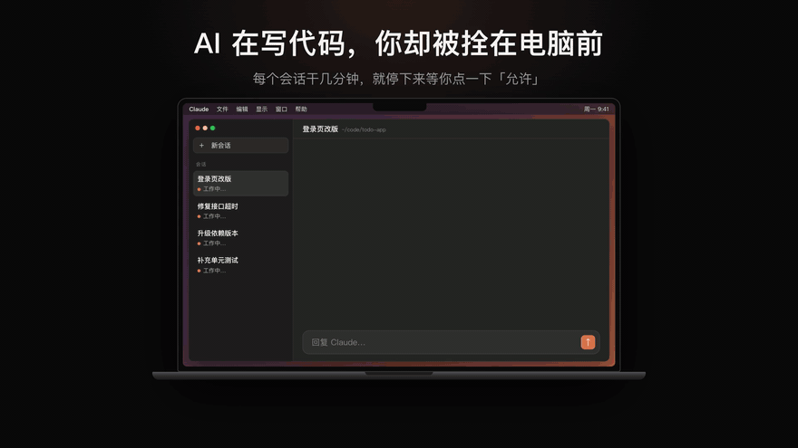
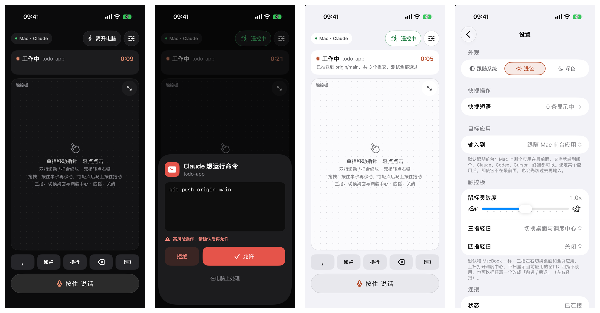

# Backseat：Vibe Coding 键盘

**把 iPhone 和 Apple Watch 变成 Vibe Coding 的语音键盘。按住说话，文字直接打进 Mac 上的 Claude Code、Codex、Cursor。不用再单独买麦克风。**

> Backseat is a voice keyboard for vibe coding. Hold to talk on your iPhone or Apple Watch and the words are typed into whatever AI coding tool is in front on your Mac. It also gives you a trackpad, a few handy keys, and Claude Code approvals on your wrist. No extra microphone needed. The apps and docs are currently in Chinese.

[](docs/demo.mp4)

## 它是什么，不是什么

Vibe Coding 主要靠说：一句话交代需求，AI 去写。于是麦克风成了最重要的输入设备，而它偏偏是电脑上最弱的一环：

- 电脑自带的麦克风要凑近了说，离远一点识别就不准。
- 单独买一支桌面麦克风要几百块，还把你固定在桌子前。
- 可你手边就有一支很好的麦克风：手机，还有手表。

Backseat 做的就是这件事：**把手机和手表接到 Mac 上，当一块无线的语音键盘用。**

它**不是**远程桌面，也不是另一个 AI 客户端：不显示 Mac 的屏幕，不接管你的会话，不经过任何服务器。它只负责「输入」，和你桌上的键盘鼠标是同一类东西，所以 Mac 上最前面是什么 App，字就打进什么 App。

除了说话，一块键盘该有的它也带了：

- 回车、⌘⏎、退格、Esc、方向键这些常用键，说完顺手就发。
- 手机屏幕当触控板，点个按钮不用伸手去够鼠标。
- AI 干完了或在等你，手机和手表震一下；Claude Code 要执行 `git push` 这类命令时，在手机 / 手表上点一下就放行。



## 能做什么

| | |
|---|---|
| **按住说话** | 手机 / 手表当麦克风，Mac 上的语音输入法负责识别，边说边上屏。上滑取消，松手保留。 |
| **触控板** | 手机屏幕就是 Mac 的触控板：移动指针、点击、拖拽、双指滚动和缩放、三指四指手势。 |
| **常用按键** | 回车、⌘⏎、换行、退格、Esc、Tab、方向键、数字，一点就发到 Mac。 |
| **审批** | Claude Code 请求权限时推到手机 / 手表，高风险命令用红色标出。 |
| **进度提醒** | 状态卡显示 AI 在工作、已完成还是在等你；完成时震动。 |
| **不开 App 也能说** | 手机侧键、控制中心、锁屏、手表侧键一按就录，灵动岛显示状态。 |
| **灵感收件箱** | 连不上 Mac 时说的话先存在手机上，连上后再发。 |

## 它是怎么工作的

```
iPhone / Apple Watch ──局域网──► Mac 上的 Backseat ──► 键盘、鼠标、语音，作用在前台 App
                                        ▲
                    Claude Code hooks ──┘（开始工作 / 完成 / 等你回复 / 请求权限）
```

- Mac 上运行一个菜单栏小程序。手机和手表通过局域网连它，配对一次后用 token 鉴权。
- 文字和按键是「模拟键盘鼠标」输入到 Mac 最前面的 App 里，所以**不挑工具**：Claude 桌面版、终端里的 Claude Code / Codex、Cursor、ChatGPT 都能用。
- 语音不在手机上识别：录音实时传到 Mac，交给 Mac 上的语音输入法（目前是豆包输入法），所以识别质量和你在电脑前用输入法说话一样。
- 进度提醒和审批来自 Claude Code 的 hooks，其他工具暂时没有这两项。

## 需要什么

- Mac：macOS 26 或更新。
- iPhone（iOS 18+）和 / 或 Apple Watch（watchOS 11+），和 Mac 在同一个局域网。
- 想要边说边上屏：Mac 上装[豆包输入法](https://shurufa.doubao.com/)。不装也能用，会改用系统自带的识别（说完整段上屏）。
- Mac 端有现成的安装包。手机和手表 App 正在 App Store 审核中，上架之前需要自己用 Xcode 编译安装。

## 安装

**1. Mac 端**

下载 [Backseat.pkg](https://github.com/wxkingstar/Backseat/releases/latest/download/Backseat.pkg)，双击安装，然后在「应用程序」里打开 Backseat。安装包经过 Apple 公证，中途要输一次开机密码。

想自己从源码编译的话，一条命令：下载源码、编译、安装、启动。

```bash
curl -fsSL https://raw.githubusercontent.com/wxkingstar/Backseat/main/scripts/install.sh | bash
```

前提是装过 Xcode 命令行工具（没装的话脚本会提示 `xcode-select --install`）。以后升级，重新运行同一条命令即可。已经 clone 了仓库的话，运行 `bash scripts/install.sh` 效果一样。

它装两样东西：

- 菜单栏 App：`/Applications/Backseat.app`
- 一块虚拟声卡「Backseat Mic」：语音输入法靠它听到手机 / 手表传来的声音（原理见下面「语音输入」）

装完系统的音频服务会自动重启一次（声音断一两秒），不用重启电脑。打开 Backseat 后（用命令安装的话会自动打开），菜单栏出现它的图标（尖括号里一支麦克风）。

第一次启动会做三件事：

- 生成配对用的 token，存在 `~/.backseat/config.json`。
- 把 Claude Code hooks 注册进 `~/.claude/settings.json`（原文件会先备份成 `settings.json.bak-backseat-*`）。
- 弹出「辅助功能」授权：系统设置 → 隐私与安全性 → 辅助功能，打开 Backseat。没有这个权限就无法替你打字和按键，提醒和审批不受影响。

如果系统防火墙询问是否允许接收连接，选**允许**。

**2. 手机 / 手表 App**

```bash
brew install xcodegen
```

```bash
bash scripts/setup.sh
```

这一步把你的 Apple 开发者团队写进 `apps/Config.local.xcconfig`，并生成 `apps/Backseat.xcodeproj`。用 Xcode 打开它，运行目标选你的 iPhone（`Backseat`），按 ⌘R。手表 App 会随手机 App 一起装上；手表需要先打开开发者模式（设置 → 隐私与安全性 → 开发者模式）。

**3. 配对**

第一次打开 App 会进入配对页。点 Mac 菜单栏的 Backseat 图标，能看到 4 位**配对码**：

- iPhone：同一局域网里的 Mac 会自动出现，选中后输入配对码。
- Apple Watch：iPhone 配对好以后自动沿用，手表上不用输入。没有 iPhone 时也可以手动填 Mac 地址（IP 或 `xxx.local`）和配对码。

配对一次即可，之后 Mac 的 IP 变了也能自动找回。要换一台 Mac，在 App 的设置里点「重新配对」。

## 语音输入

按住说话时，手表 / 手机的录音实时传到 Mac，有两种识别方式，自动选择：

| 方式 | 条件 | 效果 |
|---|---|---|
| **语音输入法**（推荐） | Mac 上装了豆包输入法 | 边说边上屏，识别质量由输入法决定 |
| Mac 内置识别 | 没装豆包输入法，或没装虚拟声卡 | 说完后整段转成文字粘贴，目前只识别中文 |

用语音输入法时，说话期间 Backseat 做三件事：把手机 / 手表传来的声音播给虚拟声卡「Backseat Mic」，把系统默认麦克风临时切到它，同时替你按住输入法的语音快捷键。说完自动把默认麦克风还原。你坐在电脑前直接用语音输入时，输入法听的还是原来的麦克风。

需要在输入法里确认两件事：

- 麦克风选「自动检测 / 跟随系统」。
- 语音输入用「长按」模式。
- 长按的快捷键和 Backseat 里的一致。Backseat 默认按 **Fn**，和豆包的默认设置相同，一般不用改。如果你在豆包里换过键（比如外接键盘没有 Fn，改成了右 ⌘），点菜单栏的 Backseat 图标 →「语音快捷键」，选成同一个键。

> 为什么要装一块虚拟声卡：macOS 可以不装驱动造一个虚拟麦克风，但系统不让它当默认麦克风，而且从它收音的程序自己要有「系统音频录制」权限。豆包输入法没有声明这个权限，读到的全是静音。所以需要一块真正的声卡。已经装了 [BlackHole](https://github.com/ExistentialAudio/BlackHole) 的话，没有 Backseat Mic 时会改用它。

**换成别的语音输入法**（比如微信输入法；只实测过豆包）：在 `~/.backseat/config.json` 里加上输入源 ID 和它的长按快捷键，然后重启 Backseat。

```json
{"token": "…", "port": 8787, "voiceIME": {"source": "输入源 ID", "holdKey": "fn"}}
```

`holdKey` 可选 `fn`、`rightCommand`、`rightOption`、`rightControl`、`rightShift`，之后也可以在菜单栏的「语音快捷键」里改。输入源 ID 用这条命令查：

```bash
defaults read com.apple.HIToolbox AppleEnabledInputSources
```

## 用法

### iPhone

只有一个主屏，从上到下：

| 区域 | 作用 |
|---|---|
| 状态卡 | Claude 是在工作、完成了还是在等你回复；连不上 Mac 时这里会提示 |
| 触控板 | 单指移动指针、轻点单击、双击、三击；按住半秒再移动（或轻点后马上按住）= 拖拽；双指滚动、捏合缩放、双指轻点右键；三指 / 四指轻扫在设置里选动作。右上角可以切到全屏触控板 |
| 快捷短语 | 一点就发。默认不显示，在设置里打开、增删改、排序 |
| 常用键 | 逗号、⌘⏎、换行、退格（在 Mac 光标处删）、所有按键（点开是其余按键：回车、Esc、Tab、空格、方向键、句号、1/2/3） |
| 说话条 | 按住说话，松手后文字留在 Mac 输入框；上滑取消并删掉这一轮说的字。有内容待处理时，左边出现 ✕ 清空输入框，右边出现 ↑ 发送 |

**不开 App 说话**：App 提供「开始 / 结束说话」快捷操作和「Backseat 说话」控制项，可以绑到手机侧键、控制中心、锁屏按钮，或在「辅助功能 → 触控 → 轻点背面」里绑到双击背面。录音时灵动岛显示状态，说完在锁屏卡片上点发送。

**灵感收件箱**：连不上 Mac 时说的话会存在手机上，用系统自带识别转成文字；连上后在主屏的收件箱里发给 Claude。

**设置**：外观（跟随系统 / 浅色 / 深色）、快捷短语、目标应用（默认跟随 Mac 前台应用，也可以固定为某个应用）、鼠标灵敏度、三指 / 四指手势。

### Apple Watch

| 页 | 作用 |
|---|---|
| 对讲 | 按住说话，松手后文字进 Mac 输入框；下方是清空、退格、发送 |
| 快捷 | 逗号、⌘⏎、换行，以及常用短语 |
| 滚轮 | 转表冠 = 滚动 Mac 上的内容 |
| 按键 | 默认是 Esc、Tab、1/2/3、上下方向键、回车；放哪些在手表设置的「按键页」里选，其余的收在「所有按键」里 |

**侧键**：手表「设置 → 操作按钮」，动作选「体能训练」，App 选 Backseat，按一下就打开并开始录音。

### 离开电脑（遥控模式）

点主屏右上角的「离开电脑」打开。打开后，Claude Code 的权限审批不再弹在电脑上，而是推到手机 / 手表：

- 点「允许」放行，高风险命令（`git push`、`--force`、`reset --hard`、`sudo` 等）会用红色标出。
- 点「在电脑上处理」，审批交还给电脑上的对话框。
- 280 秒没响应，或设备断线超过 45 秒，审批自动交还给电脑。

手表上这个模式借用一个**不保存**的「体能训练」会话保持后台运行，比平时费电，回到电脑后记得关掉。

### 人不在家

Backseat 只在局域网里工作，不经过任何服务器。人在外面想用，需要先让手机回到家里的网络（WireGuard、Tailscale 这类 VPN），然后在配对页手动填 Mac 的地址。用到的端口是 TCP 8787 和 8788。

配合远程桌面（RustDesk 等）看屏幕时，手机移动指针会在 Mac 上显示一个绿色的虚拟指针，方便在远程画面里看清位置。

## 安全与隐私

动手之前值得了解的几件事：

- **Backseat 能在你的 Mac 上打字、按键、点鼠标**，这是它的用途，也是它需要「辅助功能」权限的原因。拿到 token 的设备等同于拿到了你的键盘。
- **配对**：4 位配对码只在 Mac 菜单栏里显示，配对成功后手机保存 token，之后每个请求都带它。Claude Code 的 hook 接口只接受本机访问。
- **通信没有加密**：手机和 Mac 之间是局域网里的明文 HTTP。请只在你信任的网络里用（家里、自己的 VPN），不要把 8787 / 8788 端口直接暴露到公网。
- **录音**：只在你按住说话时录，实时传到你自己的 Mac，不经过 Backseat 的任何服务器（它没有服务器）。之后由 Mac 上的语音输入法处理，是否上传取决于输入法本身。
- **不收集数据**：没有统计、没有账号、没有联网上报。
- **手表的健康权限**：遥控模式借用「体能训练」会话让 App 保持运行，不读取也不保存任何健康数据。

## 常见问题

**说了话，Mac 上没有出字。**
依次检查：输入法的麦克风是否选了「自动检测」；输入法里长按说话的键，和菜单栏 Backseat →「语音快捷键」里选的是否是同一个（默认都是 Fn）；声卡列表里是否有「Backseat Mic」（系统设置 → 声音 → 输入）。还不行的话，退出菜单栏的 Backseat，从终端用 `bash scripts/start.sh` 启动：启动时会打印语音走的是哪种方式，每次说话也会打印收到多少声音、输入法有没有在收音。

**文字和按键输不进去，但提醒正常。**
没有「辅助功能」权限。重新编译安装后系统有时会让旧授权失效：在辅助功能列表里把 Backseat 删掉再加回来。

**手机找不到 Mac。**
确认两边在同一个 Wi‑Fi，Mac 防火墙允许了 Backseat 接收连接；路由器开了「AP 隔离」的话设备之间互相看不到。也可以点「找不到？手动填地址」直接填 Mac 的 IP。

**只用手表，不用手机可以吗？**
可以，手表上手动填 Mac 地址和配对码。

**支持 Windows / Android 吗？**
不支持，目前只有 Mac + iPhone / Apple Watch。

**支持英文语音吗？**
取决于语音输入法能识别什么；Mac 内置识别目前只识别中文。

## 卸载

- App：删除 `/Applications/Backseat.app`。
- 虚拟声卡：删除 `/Library/Audio/Plug-Ins/HAL/BackseatMic.driver`，再执行 `sudo killall coreaudiod`。
- 配置：删除 `~/.backseat`。
- hooks：删除 `~/.claude/settings.json` 里命令为 `~/.backseat/hook.sh …` 的条目。不删也行：Backseat 没在运行时，这些 hook 会立即静默退出。

## 开发

- `mac/`：Mac 端（Swift，无第三方依赖）。HTTP 服务、状态与审批队列、键盘鼠标注入、语音、菜单栏；`mac/Driver/` 是虚拟声卡驱动（C）。
- `apps/`：iOS 和 watchOS App（SwiftUI，工程由 XcodeGen 从 `project.yml` 生成）。
- `scripts/`：`install.sh` 一条命令编译安装并启动，`build-pkg.sh` 做安装包（内部调用 `build-app.sh` 和 `build-driver.sh`），`start.sh` 从终端启动 Mac 端并打印日志，`setup.sh` 写入 App 签名团队并生成工程。

改 Mac 端时不用每次装包：

```bash
bash scripts/start.sh
```

它会编译并在前台运行（虚拟声卡仍然要靠安装包装上一次）。这时「辅助功能」权限要给运行它的终端 App。

欢迎提 issue 和 PR。报告问题时请附上 macOS / iOS 版本，以及 `start.sh` 打印的相关日志。

## 许可

[MIT](LICENSE)
